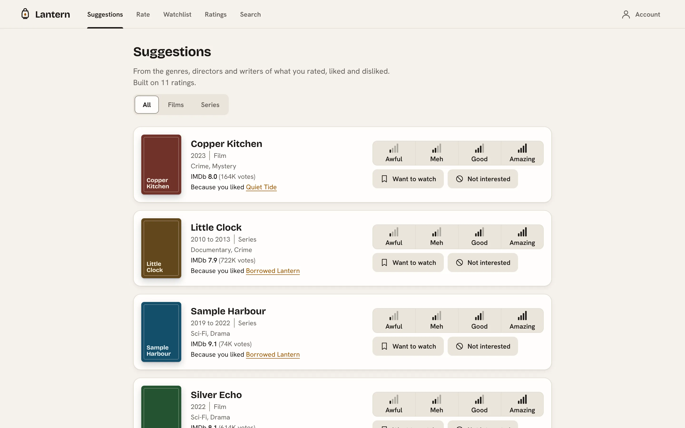
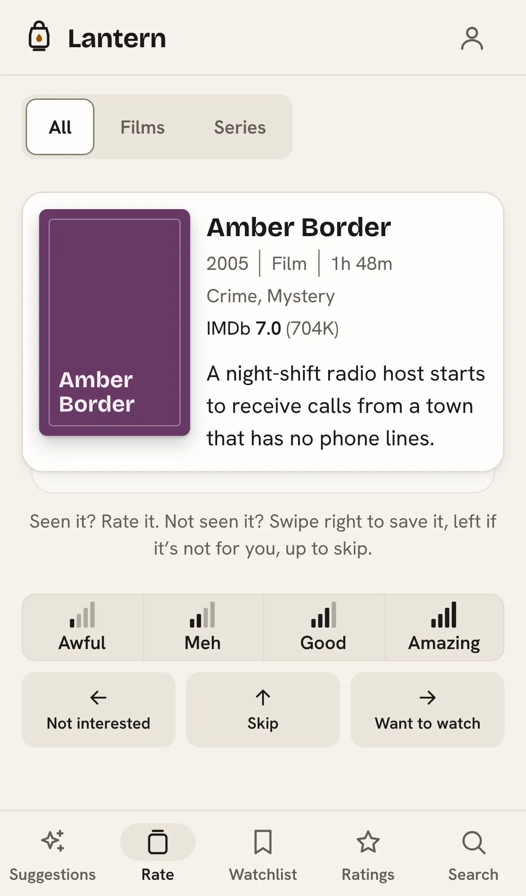
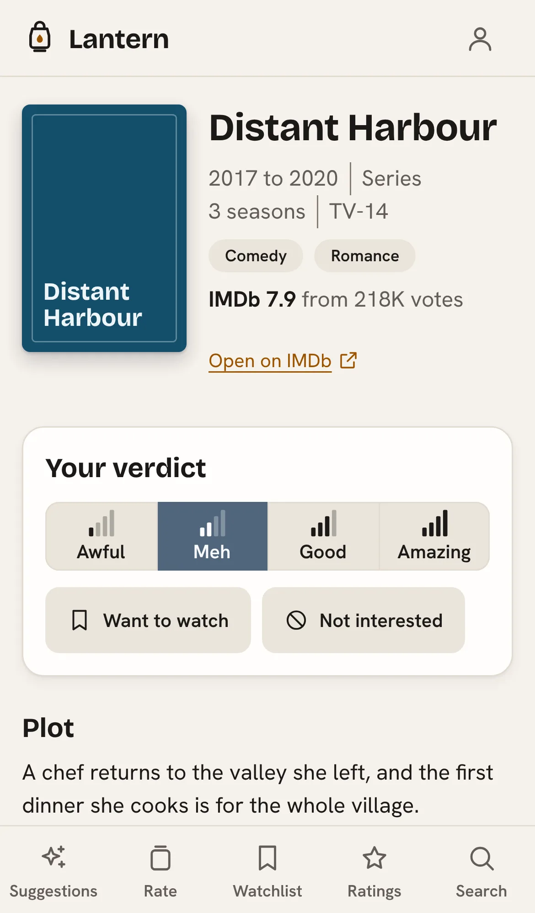

# Lantern

Rate the films and series you have watched, and get suggestions for what to watch next, each one naming
the title you liked that put it there. A one-person take on taste.io, self-hosted.

<p align="center">
  
</p>

**Status:** Personal tool. The first version was built on 2026-11-04 and redesigned ("Lamplight") on
2026-11-13. Not deployed yet; putting it on a VPS is in [docs/owner-setup.md](docs/owner-setup.md).

The magic lantern was the projector before cinema.

## What it does

- **Rate** a title awful, meh, good or amazing, mark it **not interested**, or put it on the
  **watchlist**. A title has one state, changed or cleared anywhere it shows.
- **Rating cards**: IMDb's best-known titles you haven't marked yet, one at a time. Tap a rating;
  swipe right for want to watch, left for not interested, up to skip. Undo, and keys on a desktop
  (1 to 4, the arrows, Z).
- **Search** films and series by name.
- **A title's page**: poster, plot, runtime or seasons, director, writers, cast, and the IMDb, Rotten
  Tomatoes and Metacritic scores.
- **Suggestions** on the home page: titles ranked by the genres, directors and writers of what you
  rated, likes and dislikes both, each with "Because you liked X". Plain arithmetic, no model, no
  match percentage.
- **Lists**: the watchlist, and the ratings by step with not interested beside them.

It is built for a phone first: a bottom tab bar there, a top bar from 760 px, and a Light, Dark or
System theme. English only. Sign-in is a local account or "Sign in with Ward", the owner's own sign-in
service; there is no sign-up. It leaves out what taste.io adds around the ratings: friends, match
scores and where to stream.

## Screenshots

| Rating cards on a phone | A title you rated meh |
|---|---|
|  |  |

The titles, plots and scores in these shots are invented stand-ins. The poster tiles are what Lantern
draws for a title with no poster, which is every title when there is no OMDb key. How each image was
made: [docs/images/shots.md](docs/images/shots.md).

## How it works

Lantern keeps its own list of about 66,000 films and series (those with 1,000 or more IMDb votes),
built from IMDb's free non-commercial data files by an import the owner runs by hand. Search, the
cards and the suggestions read only that list, so they cost no outside call. When a title is shown in
full, the server asks OMDb once for its poster, plot, people and scores, and keeps the answer. The
browser only ever talks to Lantern; posters come through the server too. Nothing runs in the
background.

Three npm workspaces: `shared` (the API contract as zod schemas), `server` (Fastify 5 and SQLite, with
the import and the OMDb client) and `web` (React 19 on Vite, styled with Tailwind 4). A diagram and the
request path, step by step: [docs/architecture.md](docs/architecture.md).

## Run it locally

Requires Node 24 or later.

```bash
npm ci
cp .env.example .env                       # every value may stay empty; see below for OMDB_API_KEY
npm run seed -w @lantern/server            # your local account; asks for a username and password
npm run titles:import -w @lantern/server   # IMDb's titles: about 310 MB streamed, half a minute
npm run dev                                # API on 127.0.0.1:8810, page on http://localhost:5180/lantern/
```

Then open <http://localhost:5180/lantern/> and sign in with the account you made. Without
`OMDB_API_KEY` there are no posters, plots, people or scores, and the rest works. A free key
(<https://www.omdbapi.com/apikey.aspx>) allows 1,000 requests a day.

The settings, the checks (`npm run check`), the browser specs and "Sign in with Ward" against a local
Ward: [docs/getting-started.md](docs/getting-started.md).

## Project layout

| Path | What lives there |
|---|---|
| `shared/` | The API contract: zod schemas for every answer |
| `server/` | The API: sign-in, states, the title pool and its import, OMDb, posters, suggestions |
| `web/` | The page: the cards, search, title pages, lists, suggestions; its browser specs in `web/e2e/` |
| `infrastructure/` | The container: Dockerfile and compose file |
| `docs/` | Setup, how it works, the design document, the owner's deploy steps and the README images |
| `corpus/` | The wiki (decisions, sources, data model, status) and the numbered briefs that built it |

## Docs

- [docs/](docs/README.md): getting started, architecture, the Lamplight design, the owner's setup, and
  how the images here were made
- [corpus/](corpus/index.md): the project wiki, with the decisions and their reasons, where things
  stand, and the briefs

## Credits

Information courtesy of IMDb (<https://www.imdb.com>). Used with permission. IMDb's data is used
for personal, non-commercial use only. Details and scores from [OMDb](https://www.omdbapi.com/)
(CC BY-NC 4.0). Not endorsed by or affiliated with IMDb.

## License

No license yet; all rights reserved.
