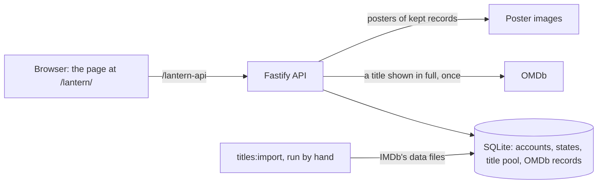

# How Lantern works

One screen. The detail and the reasons live in the [project wiki](../corpus/index.md).

Lantern is three npm workspaces. `shared` holds the API contract as zod schemas: the server builds
its answers from them and the page parses answers with them. `server` is Fastify 5 on SQLite
(better-sqlite3), with the title import and the OMDb client. `web` is React 19 on Vite, styled with
Tailwind 4 and routed by a small hand-written router. In development Vite serves the page at
`/lantern/` and forwards `/lantern-api` to the API; on the VPS, Caddy does both.

## A request, step by step

1. The page calls the API under `/lantern-api/v1`. Every route but `GET /v1/health` needs a session,
   from a local account or "Sign in with Ward", and every write must come from the page's own origin.
2. Search, the cards, the lists and the suggestions read the title pool and your states from SQLite.
   None of them calls out.
3. When a title is shown in full (its page, or the card on screen), the server asks OMDb for its
   record once and keeps it. Without `OMDB_API_KEY` that route answers 503 `no_key`.
4. Posters come through the server's own `/v1/posters/:id`, and only for records it already keeps.
   The browser never calls OMDb or IMDb.
5. Suggestions build a taste profile from your ratings (awful -2 to amazing +2) over genres, directors
   and writers, score every pool title you haven't marked, and name the liked title that adds the most
   as the reason.
6. Nothing runs in the background. The server works only while it answers a request, and the pool
   changes only when the owner runs the import, about monthly.

## Read more

- Wiki: [architecture](../corpus/wiki/architecture.md) (workspaces, request path, settings),
  [data model](../corpus/wiki/data-model.md), [sign-in](../corpus/wiki/sign-in.md),
  [the title pool](../corpus/wiki/titles.md), [OMDb calls](../corpus/wiki/source-calls.md),
  [suggestions](../corpus/wiki/suggestions.md), [the page](../corpus/wiki/web-app.md).
- The look: [design.md](design.md).
- Source: `server/src/app.ts` (what the API registers), `server/src/features/` (one folder per
  domain), `shared/src/` (the contract), `web/src/route.ts` (the pages) and `web/src/Shell.tsx` (the
  frame).
